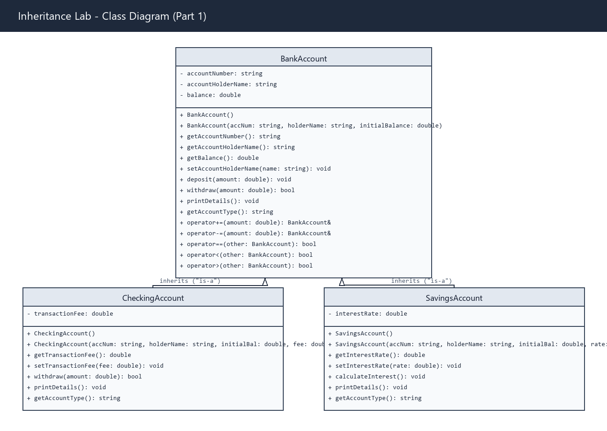
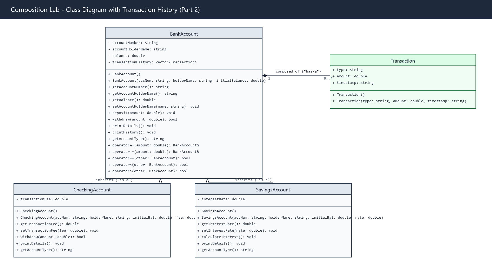
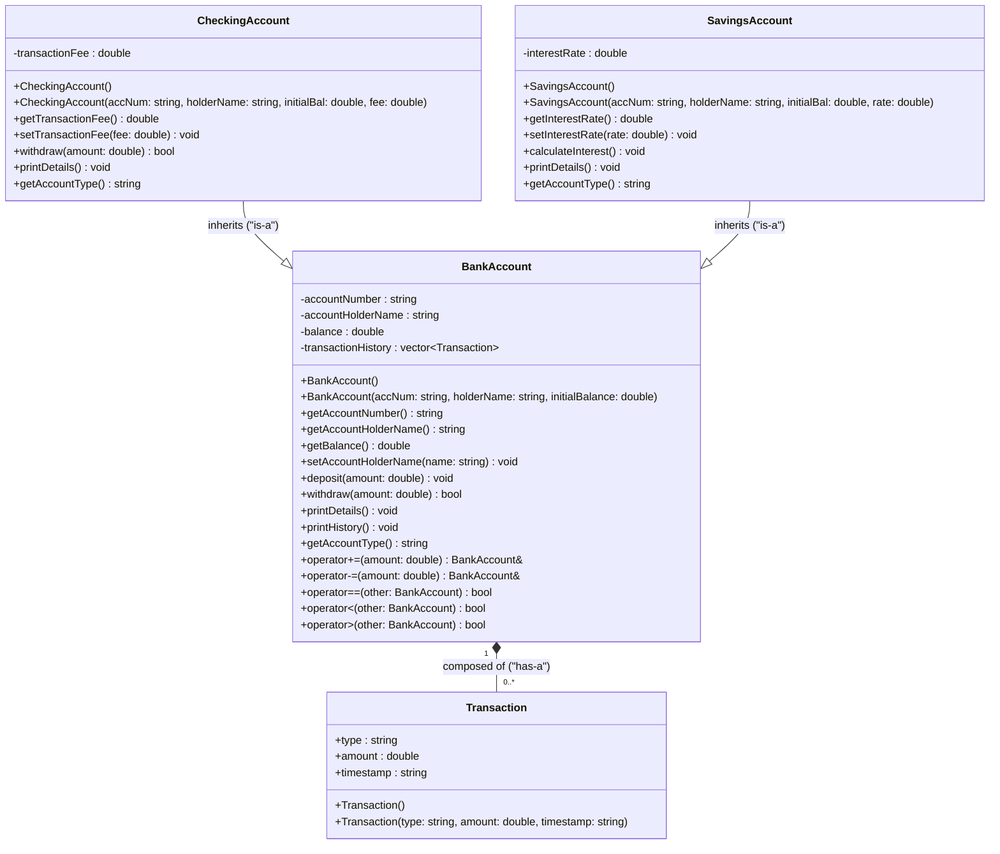

# Composition Lab: Inheritance & Composition in C++

This lab extends our previous Inheritance banking system by introducing **Composition** ("has-a" relationship). We model a `Transaction` class and embed it inside `BankAccount` using `std::vector<Transaction>` to track complete transaction histories across all accounts (including derived `CheckingAccount` and `SavingsAccount` instances).

---

## Architecture Overview: "is-a" vs "has-a"

1. **Inheritance ("is-a")**:
   - `CheckingAccount` **is a** `BankAccount` (inherits account number, balance, deposit/withdraw behavior, and fee logic).
   - `SavingsAccount` **is a** `BankAccount` (inherits core account behavior and adds interest calculations).

2. **Composition ("has-a")**:
   - `BankAccount` **has a** collection of `Transaction` records (`std::vector<Transaction> transactionHistory`).
   - Every time `deposit()` or `withdraw()` is called on an account, a new `Transaction` object is created and logged to the account's history.
   - Because `CheckingAccount` and `SavingsAccount` inherit from `BankAccount`, both automatically inherit this transaction history logging capability without duplicating code.

---

## UML Class Diagrams

### Part 1: Inheritance Baseline (Before Composition)


### Part 2: Extended Model with Composition


> **Note:** Editable draw.io source files are also included in the repository:
> - [`Inheritance_Lab_UML.drawio`](Inheritance_Lab_UML.drawio)
> - [`Composition_Lab_UML.drawio`](Composition_Lab_UML.drawio)

### GitHub Mermaid Diagram



---

## Data Dictionary

### Composed Class: `Transaction`
| Member | Type | Access | Description |
|---|---|---|---|
| `type` | `std::string` | `public` | Type of transaction (e.g., `"Deposit"`, `"Withdrawal"`). |
| `amount` | `double` | `public` | Dollar amount of the transaction. |
| `timestamp` | `std::string` | `public` | Formatted date and time when the transaction took place. |

### Base Class: `BankAccount`
| Member | Type | Access | Description |
|---|---|---|---|
| `accountNumber` | `std::string` | `protected` | Unique account identifier. |
| `accountHolderName` | `std::string` | `protected` | Name of the account holder. |
| `balance` | `double` | `protected` | Current balance. |
| `transactionHistory` | `std::vector<Transaction>` | `private` | **Composed collection** logging each transaction. |
| `deposit(double amount)` | `void` | `public` | Adds funds to balance and records a `Transaction`. |
| `withdraw(double amount)` | `virtual bool` | `public` | Deducts funds and records a `Transaction`. |
| `printHistory()` | `void` | `public` | Displays the formatted transaction ledger for the account. |

### Derived Class: `CheckingAccount`
| Member | Type | Access | Description |
|---|---|---|---|
| `transactionFee` | `double` | `private` | Fee applied to every withdrawal. |
| `withdraw(double amount)` | `bool (override)` | `public` | Deducts `amount + fee` via base withdrawal, automatically recording it in history. |

### Derived Class: `SavingsAccount`
| Member | Type | Access | Description |
|---|---|---|---|
| `interestRate` | `double` | `private` | Annual interest rate (e.g. `0.05` for 5%). |
| `calculateInterest()` | `void` | `public` | Computes earned interest and deposits it, logging it in history. |

---

## Build & Execution Instructions

### Using Clang++ or G++:
```bash
clang++ -std=c++17 -Wall -Wextra BankAccount.cpp CheckingAccount.cpp SavingsAccount.cpp main.cpp -o Composition_Lab.exe
./Composition_Lab.exe
```

### Using CMake:
```bash
mkdir build
cd build
cmake ..
cmake --build .
./Composition_Lab.exe
```

---

## Sample Run Output

```text
========================================================
     COMPOSITION LAB: TRANSACTION HISTORY DEMO         
========================================================

>>> Step 1: Testing CheckingAccount with Composition <<<
----------------------------------------
  Account Type    : Checking Account
  Account Number  : CHK-1001
  Holder Name     : Dick Butkis
  Balance         : $1000.00
  Transaction Fee : $2.50
----------------------------------------

[Action] Depositing $250.00...
[Action] Depositing $150.00...
[Action] Withdrawing $100.00 (with $2.50 fee)...
[Action] Withdrawing $50.00 (with $2.50 fee)...

Calling checking.printHistory():

=======================================================
  Transaction History for Checking Account #CHK-1001
  Holder: Dick Butkis
=======================================================
#    Type           Amount         Timestamp             
-------------------------------------------------------
1    Deposit        $250.00        2026-11-03 06:01:43   
2    Deposit        $150.00        2026-11-03 06:01:43   
3    Withdrawal     $102.50        2026-11-03 06:01:43   
4    Withdrawal     $52.50         2026-11-03 06:01:43   
-------------------------------------------------------
  Current Balance: $1245.00
=======================================================

>>> Step 2: Testing SavingsAccount with Composition <<<
----------------------------------------
  Account Type   : Savings Account
  Account Number : SAV-2001
  Holder Name    : Dick Butkis
  Balance        : $2500.00
  Interest Rate  : 5.00% (0.05 decimal)
----------------------------------------

[Action] Depositing $500.00...
[Action] Withdrawing $200.00...
[Action] Depositing $100.00...
[Action] Calculating interest (5% on current balance)...

Calling savings.printHistory():

=======================================================
  Transaction History for Savings Account #SAV-2001
  Holder: Dick Butkis
=======================================================
#    Type           Amount         Timestamp             
-------------------------------------------------------
1    Deposit        $500.00        2026-11-03 06:01:43   
2    Withdrawal     $200.00        2026-11-03 06:01:43   
3    Deposit        $100.00        2026-11-03 06:01:43   
4    Deposit        $145.00        2026-11-03 06:01:43   
-------------------------------------------------------
  Current Balance: $3045.00
=======================================================
```
